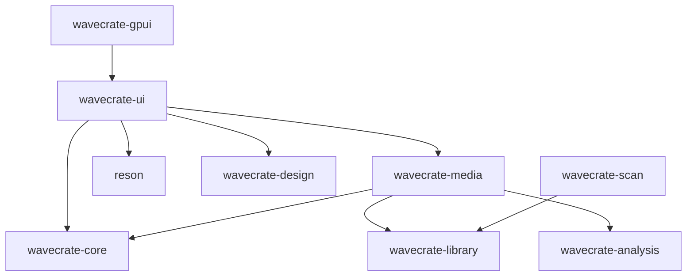

# GPUI workspace architecture

The repository root is the active GPUI Cargo workspace. `cargo run` starts the
thin `wavecrate-gpui` executable. The Radiant frontend is archived under
`reference/radiant` and is not a build dependency.

This structure takes its composition-root and domain-ownership approach from
[Rox's workspace](https://github.com/zealsprince/rox/blob/332b2579b0d72ed4b9e1ca76163e789be7c9732e/Cargo.toml)
and [architecture](https://github.com/zealsprince/rox/blob/332b2579b0d72ed4b9e1ca76163e789be7c9732e/docs/02-architecture/01-overview.md).
It adapts the idea to Wavecrate's existing engines and current implementation;
it does not duplicate Rox's full crate inventory or incorporate its code.

## Crate ownership

| Crate | Owns | Must not own |
| --- | --- | --- |
| `wavecrate-gpui` | Executable entrypoint, launch arguments, composition | Widgets, scanning, decoding, business rules |
| `wavecrate-core` | Sample identities and metadata, pure folder-tree/scope projection, filtering/sorting projection, focus reconciliation, display formatting | GPUI types, filesystem calls, audio devices, databases |
| `wavecrate-media` | Read-only folder enumeration (canonical root and relative directory inventory) and bounded waveform preparation, cancellation checks | Window state, input routing, source mutation, persistent source registration |
| `wavecrate-design` | GPUI-independent semantic theme schema, default tokens, validation, bounded import | GPUI widgets, filesystem mutation, window state |
| `wavecrate-ui` | GPUI bootstrap, browser views and interaction, reusable text input, UI task/transport coordination | Filesystem/database authority or realtime audio processing |
| `reson` | Existing audio engine, playback runtime, device/output processing | GPUI views |
| `wavecrate-library` | Existing database, profile ownership, configuration and source-capability primitives | GPUI views |
| `wavecrate-scan` | Existing persistent scanning and scan-writer mechanisms | GPUI views |
| `wavecrate-analysis` | Existing decoding, feature extraction and similarity machinery | GPUI views |



GPUI is a UI dependency. Core projections operate on supplied data and use pure
path identities; canonicalization happens once during background scanning.
Filtering and sorting must not probe the filesystem. UI selection follows
sample identity, not the position of a row in the filtered list.

The current media scanner is a read-only browsing service. It returns a canonical
root and every traversed relative directory, including empty directories, so the
UI can project a complete session-only folder tree without doing filesystem work
while rendering. It does not replace
the persistent scanner's ownership, watcher, readiness, journal, or recovery
contracts. Those services will be integrated when persistent sources are ported.

## UI organization

The UI crate separates browser state/lifecycle, rendering, transport coordination,
and the native text-input component into modules. Only the bootstrap function
needs to be public to the executable. Do not expose all internal fields merely
to move code between modules.

Search owns text editing, selection, composition, and clipboard actions while it
has focus. Browser focus owns sample navigation and transport keys. Escape from
search returns focus to browsing. Rendering must give virtual lists definite
viewport bounds and constrain waveform drawing to its panel.

Theme ownership follows the same boundary. `wavecrate-design` defines a complete
versioned JSON document and validates every color, font metric, and density
value without depending on GPUI. `wavecrate-ui` stores the active theme in a
GPUI global and converts tokens at the rendering edge. Import, reload, and
reset actions run through bounded background reads; an invalid or stale result
cannot replace the last valid theme.

The canonical theme is [themes/wavecrate.json](../themes/wavecrate.json). A
custom theme must contain the required fields in that document and use schema
version `1`; the optional `motion` group defaults to the built-in timings for
older themes. Open a JSON file from the gear settings panel, use `Reload` after
editing it, and use `Default` to restore the built-in palette. Unknown fields,
malformed colors, unsupported versions, oversized files, and incoherent
dimensions are rejected with an error shown in the status bar. The embedded
Ioskeley Mono font remains the default display family and is registered during
GPUI startup. Density values must also leave room for the 960×560 minimum
window, the fixed sample columns, and a short visible browser list.

Copy the canonical JSON to create a theme. Colors accept `#RRGGBB` or
`#RRGGBBAA`; dimensions use logical points. Imports must be regular UTF-8 files
no larger than 128 KiB. Font families fall back through the platform font system
when unavailable. Theme selection is session-only until isolated application
profiles are implemented; reopening the app restores the built-in theme.

Motion timing and deterministic envelopes belong to `wavecrate-design`; GPUI
frame requests and drawing belong to `wavecrate-ui`. Loading indicators must
derive from current pending work, never from the mere existence of a retained
task handle. Completion, failure, cancellation, and disabled motion must end
frame requests. Disabled motion retains a static busy cue. Hover styling must
not start a timer. Animation frames reuse waveform geometry and folder-row
projections rather than rebuilding them.

Focus feedback follows the input event and stable source/folder/sample identity,
not a virtual row index. Reconciliation, sorting, and rendering must not restart
its envelope. Scroll fades derive their targets from the laid-out viewport and
scroll range. Reversing a transition starts from its current opacity; a settled
fade must not keep requesting frames. Gradient overlays must remain inside the
list viewport and leave pointer and scroll input available to the list.

## Work and lifecycle

The UI keeps source roots, selected relative folders, expansion sets, and direct
or descendant scope in an in-memory session registry. Forgetting a source removes
that record only; no source database or source folder is opened or changed. The
UI schedules filesystem and decoding work off its event thread and consumes
results only if their request identity is still current. Replacing a scan
cancels the prior traversal. Playback initialization and progress events retain
their intent/request fences through module moves. Audio processing remains in
Reson; moving a control into a UI module does not move DSP into the UI.

New persistent workflows must acquire the existing profile/source authorities
before admitting durable work. Development defaults must remain separate from
the live Wavecrate profile. The current GPUI browser writes no library data.

## Development

```sh
cargo run -- /path/to/samples
cargo check --locked -p wavecrate-gpui
cargo test --locked -p wavecrate-core -p wavecrate-design -p wavecrate-media -p wavecrate-ui -p wavecrate-gpui
./scripts/build-gpui-macos.sh
```

The macOS script creates an ad-hoc-signed development `.app` under Cargo's
ignored target directory. It is not a notarized distribution build. The parity
register in `GPUI_MIGRATION.md` remains the feature-completion authority.
