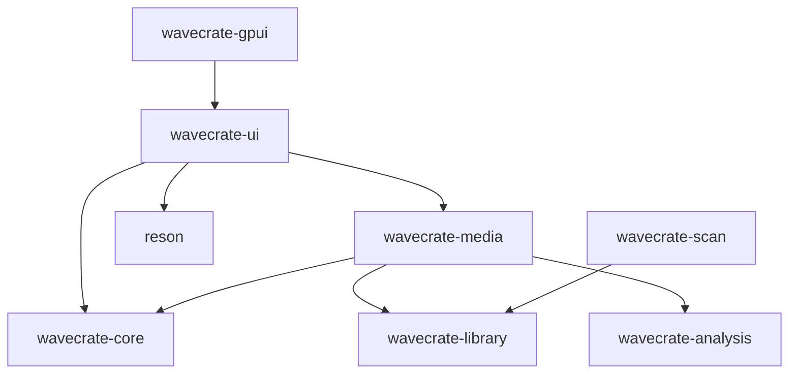

# GPUI workspace architecture

The repository root is the active GPUI Cargo workspace. `cargo run` starts the
thin `wavecrate-gpui` executable. The Radiant frontend is archived under
`reference/radiant` and is not a build dependency.

This structure takes its composition-root and domain-ownership approach from
[Rox's workspace](https://github.com/zealsprince/rox/blob/332b2579b0d72ed4b9e1ca76163e789be7c9732e/Cargo.toml)
and [architecture](https://github.com/zealsprince/rox/blob/332b2579b0d72ed4b9e1ca76163e789be7c9732e/docs/02-architecture/01-overview.md).
It adapts the idea to Wavecrate's existing engines and current implementation;
it does not duplicate Rox's full crate inventory or incorporate its code.

## Crate ownership

| Crate | Owns | Must not own |
| --- | --- | --- |
| `wavecrate-gpui` | Executable entrypoint, launch arguments, composition | Widgets, scanning, decoding, business rules |
| `wavecrate-core` | Sample identities and metadata, filtering/sorting projection, focus reconciliation, display formatting | GPUI types, filesystem calls, audio devices, databases |
| `wavecrate-media` | Read-only folder enumeration and bounded waveform preparation, cancellation checks | Window state, input routing, source mutation, persistent source registration |
| `wavecrate-ui` | GPUI bootstrap, browser views and interaction, reusable text input, UI task/transport coordination | Filesystem/database authority or realtime audio processing |
| `reson` | Existing audio engine, playback runtime, device/output processing | GPUI views |
| `wavecrate-library` | Existing database, profile ownership, configuration and source-capability primitives | GPUI views |
| `wavecrate-scan` | Existing persistent scanning and scan-writer mechanisms | GPUI views |
| `wavecrate-analysis` | Existing decoding, feature extraction and similarity machinery | GPUI views |



GPUI is a UI dependency. Core projections operate on supplied data and use pure
path identities; canonicalization happens once during background scanning.
Filtering and sorting must not probe the filesystem. UI selection follows
sample identity, not the position of a row in the filtered list.

The current media scanner is a read-only browsing service. It does not replace
the persistent scanner's ownership, watcher, readiness, journal, or recovery
contracts. Those services will be integrated when persistent sources are ported.

## UI organization

The UI crate separates browser state/lifecycle, rendering, transport coordination,
and the native text-input component into modules. Only the bootstrap function
needs to be public to the executable. Do not expose all internal fields merely
to move code between modules.

Search owns text editing, selection, composition, and clipboard actions while it
has focus. Browser focus owns sample navigation and transport keys. Escape from
search returns focus to browsing. Rendering must give virtual lists definite
viewport bounds and constrain waveform drawing to its panel.

## Work and lifecycle

The UI schedules filesystem and decoding work off its event thread and consumes
results only if their request identity is still current. Replacing a scan
cancels the prior traversal. Playback initialization and progress events retain
their intent/request fences through module moves. Audio processing remains in
Reson; moving a control into a UI module does not move DSP into the UI.

New persistent workflows must acquire the existing profile/source authorities
before admitting durable work. Development defaults must remain separate from
the live Wavecrate profile. The current GPUI browser writes no library data.

## Development

```sh
cargo run -- /path/to/samples
cargo check --locked -p wavecrate-gpui
cargo test --locked -p wavecrate-core -p wavecrate-media -p wavecrate-ui -p wavecrate-gpui
./scripts/build-gpui-macos.sh
```

The macOS script creates an ad-hoc-signed development `.app` under Cargo's
ignored target directory. It is not a notarized distribution build. The parity
register in `GPUI_MIGRATION.md` remains the feature-completion authority.
