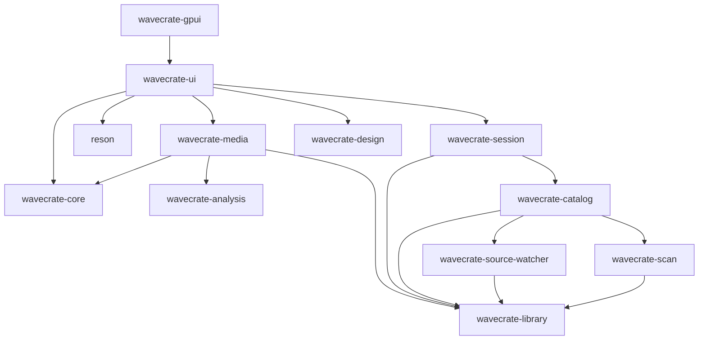

# GPUI workspace architecture

The repository root is the active GPUI Cargo workspace. `cargo run` starts the
thin `wavecrate-gpui` executable. The Radiant frontend is archived under
`reference/radiant` and is not a build dependency.

This structure takes its composition-root and domain-ownership approach from
[Rox's workspace](https://github.com/zealsprince/rox/blob/332b2579b0d72ed4b9e1ca76163e789be7c9732e/Cargo.toml)
and [architecture](https://github.com/zealsprince/rox/blob/332b2579b0d72ed4b9e1ca76163e789be7c9732e/docs/02-architecture/01-overview.md).
It adapts the idea to Wavecrate's existing engines and current implementation;
it does not duplicate Rox's full crate inventory or incorporate its code.

## Crate ownership

| Crate | Owns | Must not own |
| --- | --- | --- |
| `wavecrate-gpui` | Executable entrypoint, launch arguments, composition | Widgets, scanning, decoding, business rules |
| `wavecrate-core` | Sample identities and metadata, pure folder-tree/scope projection, filtering/sorting projection, focus reconciliation, waveform viewport/region geometry, display formatting | GPUI types, filesystem calls, audio devices, databases |
| `wavecrate-media` | Read-only folder enumeration (canonical root and relative directory inventory) and bounded waveform preparation/similar-section matching, cancellation checks | Window state, input routing, source mutation, persistent source registration |
| `wavecrate-design` | GPUI-independent semantic theme schema, default tokens, validation, bounded import | GPUI widgets, filesystem mutation, window state |
| `wavecrate-ui` | GPUI bootstrap, browser views and interaction, reusable text input, UI task/transport coordination | Filesystem/database authority or realtime audio processing |
| `wavecrate-session` | App-owned source-registry and typed UI-preference commands, immutable snapshots, isolated development-profile persistence, and synchronous shutdown | Widgets, scan enumeration, source-local files, or view lifetime |
| `wavecrate-catalog` | Bounded authoritative source audits, safe WAV display metadata, and revision-fenced snapshots in profile-owned catalog databases | Widgets, independent profile acquisition, source-local databases, audio-file mutation, or raw watcher publication |
| `wavecrate-source-watcher` | Native root/parent watch handles, lexical event classification, and one coalesced lifecycle-fenced hint | Scanning, database access, UI publication, or audit scheduling |
| `wavecrate-platform` | Bounded native file-drag admission and retained AppKit session lifetime | File discovery, source mutation, GPUI entities, or browser selection |
| `reson` | Existing audio engine, playback runtime, device/output processing | GPUI views |
| `wavecrate-library` | Existing database, profile ownership, configuration and source-capability primitives | GPUI views |
| `wavecrate-scan` | Existing persistent scanning and scan-writer mechanisms | GPUI views |
| `wavecrate-analysis` | Existing decoding, feature extraction and similarity machinery | GPUI views |



GPUI is a UI dependency. Core projections operate on supplied data and use pure
path identities; canonicalization happens once during background scanning.
Filtering and sorting must not probe the filesystem. UI selection follows
sample identity, not the position of a row in the filtered list.

Similar-section matching belongs to `wavecrate-media`: a retained WAV read lease,
strong source revision and exact frame anchor fence the native profile algorithm.
It samples bounded neighborhoods rather than retaining decoded PCM. The browser
owns one active scan and at most one replacement; source/play-selection changes
cancel ownership, and completion must still match the exact context and anchor.
Match painting and edit-only pointer selection remain in `wavecrate-ui`, with
semantic fill/rail/hover colors in `wavecrate-design`.

The platform drag foundation accepts a borrowed window handle and prepared
absolute paths. It requires the AppKit main thread, an originating-window mouse
event, and a currently held primary button. Native objects remain retained until
the session's completion callback; notification receivers do not own that lifetime.
The adapter performs no source-file probing or mutation. Browser integration is
still pending, and non-macOS targets currently return an unsupported-platform error.
The foundation passed nine tests, strict all-target Clippy, and macOS/Linux-target
checks. Independent review found a stale mouse-event admission issue, corrected by
the current-button guard. Native drag execution has not yet been exercised.

`PlaybackNavigationHistory` owns a bounded sequence of file paths and normalized
audition spans in the core crate. The browser records newly accepted playback
requests; history replay and automatic audio-output resumption do not add
entries. Back/forward navigation restores a cached registered source and its
folder projection without filesystem work on the UI thread. Playback uses the
current volume and loop preference. This navigation history is session-only;
it is separate from persistent listening statistics and undo history.

`BrowserSelection` owns explicit batch membership and the range anchor in the
core crate. The focused sample remains a separate UI concern and alone drives
waveform loading and audition. Sorting preserves selected identities; filtering
and refresh discard identities no longer visible. Plain pointer focus clears
explicit membership, while plain arrow focus preserves it. Source and folder
navigation clear batch membership. These choices remain session-only.

The current media scanner is a read-only browsing service. It returns a canonical
root and every traversed relative directory, including empty directories, so the
UI can project a complete folder tree without doing filesystem work while
rendering. `wavecrate-session` owns only the ordered registry of accepted
canonical roots in the isolated `gpui-development` profile. It submits through
the existing library writer and never opens a source-local database or writes a
source folder. Persistent scanning, watcher, readiness, journal, and recovery
contracts remain outside this slice.

The session starts the catalog separately from the current browser projection.
It uses a clone of the session's existing writable profile
capability and retains an exclusive lease on each catalog's direct profile
child directory. Every write phase revalidates that profile and child binding.
An authoritative snapshot carries source identity, lifecycle generation, root
identity, and the exact revision shared by its manifest and directory truth.
Incomplete traversal cannot mint a complete-audit receipt. Catalog audits stop
before optional content verification, which may advance the source revision.

Directory generations are staged in bounded, revision-neutral transactions;
the final transaction activates the complete generation and records the audit
identity at the committed manifest revision. Catalog maintenance reclaims
abandoned staging and inactive generations under its exclusive child lease.
The general scanner does not reclaim other scanners' staging generations.
Commands and completion events both have bounded admission; rejected commands
do not invalidate accepted work. Session access exposes loading, ready,
unavailable, and closed states without forwarding events through another queue.
Submission and closure share a short admission lock; polling does not wait for
catalog I/O. Catalog failure leaves the registry and preference lanes usable,
and session shutdown joins the catalog before releasing the profile guard.
Browser projections are built from catalog snapshots on background tasks. The
`wavecrate-source-watcher` adapter captures filesystem hints for catalog-owned
scheduling. Automatic audits run only when queued commands and retained events
have drained. Changes during a scan retain a follow-up obligation; watcher
outages use bounded retries and periodic fallback audits. Each handle owns a distinct
signal, and shutdown closes callback acceptance before dropping the backend.
Callbacks retain no event paths and perform no filesystem probes or database
work. Root-only ambiguous events remain distinguishable from descendant
changes so the owner can avoid database-write feedback loops. Backend overflow
always requires authoritative reconciliation.

WAV waveforms use two buffered streaming passes: the first finds the global
mono peak and the second feeds normalized frames into bounded peak and frequency
columns. They retain the full source timeline, including silence, without
retaining PCM for the entire file. Cancellation is checked during both passes;
the UI also fences completion by selection generation. Waveform loading has no
source-write authority and shares no connection with persistent scanning.

`WaveformViewport` in the core crate owns normalized zoom, anchor preservation,
panning, and the minimum 256-frame visible span. The media preview retains the
exact frame count as a scalar. UI gestures translate visible coordinates back
into file coordinates; viewport changes never rewrite audition or history spans.
Waveform geometry caches include the viewport, and overlays clip to it. Current
zoom resamples the bounded overview; finer detail decoding remains separate.

## UI organization

The UI crate separates browser state/lifecycle, rendering, transport coordination,
and the native text-input component into modules. Only the bootstrap function
needs to be public to the executable. Do not expose all internal fields merely
to move code between modules.

Search owns text editing, selection, composition, and clipboard actions while it
has focus. Browser focus owns sample navigation and transport keys. Escape from
search returns focus to browsing. Rendering must give virtual lists definite
viewport bounds and constrain waveform drawing to its panel.

Theme ownership follows the same boundary. `wavecrate-design` defines a complete
versioned JSON document and validates every color, font metric, and density
value without depending on GPUI. `wavecrate-ui` stores the active theme in a
GPUI global and converts tokens at the rendering edge. Import, reload, and
reset actions run through bounded background reads; an invalid or stale result
cannot replace the last valid theme.

The canonical theme is [themes/wavecrate.json](../themes/wavecrate.json). A
custom theme must contain the required fields in that document and use schema
version `1`; the optional `motion` group defaults to the built-in timings for
older themes. The optional `colors.waveform_playhead` token controls the cursor
independently of the frequency layers and defaults to the pale reference color.
Open a JSON file from the gear settings panel, use `Reload` after
editing it, and use `Default` to restore the built-in palette. Unknown fields,
malformed colors, unsupported versions, oversized files, and incoherent
dimensions are rejected with an error shown in the status bar. The embedded
Ioskeley Mono font remains the default display family and is registered during
GPUI startup. Density values must also leave room for the 960×560 minimum
window, the fixed sample columns, and a short visible browser list.

Copy the canonical JSON to create a theme. Colors accept `#RRGGBB` or
`#RRGGBBAA`; dimensions use logical points. Imports must be regular UTF-8 files
no larger than 128 KiB. Font families fall back through the platform font system
when unavailable. The complete validated theme is restored from the isolated
application profile; the optional source path is reread only when the user
explicitly chooses Reload. A missing source file therefore does not erase the
restored theme.

Motion timing and deterministic envelopes belong to `wavecrate-design`; GPUI
frame requests and drawing belong to `wavecrate-ui`. Loading indicators must
derive from current pending work, never from the mere existence of a retained
task handle. Completion, failure, cancellation, and disabled motion must end
frame requests. Disabled motion retains a static busy cue. Hover styling must
not start a timer. Animation frames reuse waveform geometry and folder-row
projections rather than rebuilding them.

Focus feedback follows the input event and stable source/folder/sample identity,
not a virtual row index. Reconciliation, sorting, and rendering must not restart
its envelope. Scroll fades derive their targets from the laid-out viewport and
scroll range. Reversing a transition starts from its current opacity; a settled
fade must not keep requesting frames. Gradient overlays must remain inside the
list viewport and leave pointer and scroll input available to the list.

## Work and lifecycle

The browser keeps selected relative folders, expansion sets, direct or descendant
scope, and scan results in an in-memory session registry. An app-owned
`SourceRegistryGlobal` persists only canonical roots through `wavecrate-session`
after a scan succeeds. Restored roots receive their durable IDs and empty
session data; they do not trigger an automatic scan or audition. Forgetting a
source stages removal in the same service and keeps it hidden until the command
and durable snapshot are acknowledged. No source-local database is opened and
source folders are read without mutation. The UI schedules filesystem and decoding work off
its event thread and consumes results only if their request identity is still
current. Replacing a scan cancels the prior traversal. Playback initialization
and progress events retain their intent/request fences through module moves.
Audio processing remains in Reson; moving a control into a UI module does not
move DSP into the UI.

Known source IDs activate the session-owned catalog. The browser registers only
the active source lifecycle, applies cached and audited snapshots through a
cancellable background projection, and retires old registrations on switching.
Snapshot projection never reopens file paths: membership and directories come
from the authoritative snapshot, and optional duration/sample-rate fields come
from bounded descriptor-checked WAV headers in the catalog worker. The existing
source-service timer drains bounded catalog events while work is pending.
Failures retain the last coherent rows. Profile-owned catalog children remain
leased until the session has closed catalog admission and joined its worker.

Audition output routing is split between the UI and the existing Reson output
boundary. `wavecrate-session` stores only the optional host, device, sample
rate, and buffer request in its typed preference stream; it does not enumerate
hardware or open an audio stream. `wavecrate-ui` discovers choices off the UI
thread and opens `AudioPlayer::from_config` through a single-flight,
generation-fenced task. A resolved Reson output, including fallback and the
actual buffer size, is shown separately from the requested settings. Passive
preference snapshots update the request for the next audition; an explicit
choice reopens the runtime and resumes the still-current audition only after a
successful open. View destruction cancels UI tasks, while runtime shutdown
remains nonblocking.

New persistent workflows must acquire the existing profile/source authorities
before admitting durable work. Development defaults must remain separate from
the live Wavecrate profile. The current source registry uses only the isolated
`gpui-development` profile and writes no source-local metadata or audio files.
Theme, motion, autoplay, and loop preferences use the session's separate typed
preference stream in that profile; sample selection and scan projections remain
session-only.

The source-registry service is application-owned and separate from view lifetime.
GPUI 0.2.2 allows only 100 ms for quit-observer futures, which is not a durable
writer-drain guarantee. The service closes admission and joins its owner
synchronously in the quit callback before returning a ready future; SQLite work
stays on the owner thread. This termination-only wait is not placed in ordinary
view destruction or render paths. Release profile guards only after accepted
commands have drained and database connections have closed. An asynchronous quit
future alone does not satisfy this ordering.

## Live playmark timing contract

Interactive duration editing uses live retargeting that must carry an immutable complete target (selection span, loop mode and metronome
configuration), a monotonic target generation, and the playback identity, path,
waveform generation, playback epoch and output generation that admitted it.
Normalized preparation analyzes the captured target span. Completion checks that
anchor and latest target generation; equality with the formerly accepted span is
not a freshness check, because an earlier retarget can be acknowledged while a
newer target is still preparing. Never reconstruct a prepared target from mutable
selection or accepted playback state.

Runtime request identities remain separate from desired target generations.
Acknowledgements may update confirmed state, but an older response cannot clear
or replace a newer desired target. Confirmation requires configured source-frame
bounds, loop mode and metronome state, together with identity/generation fences.
Later progress must expose the same configuration and the last successfully
applied retarget request ID because a disposable retarget response may be lost.
The returned frame denominator belongs to the configured playback plan; it is
not a promise of exact underlying WAV length. Confirm using that persistent
request identity and valid returned frame bounds, without duplicating the
runtime's floating-point quantization in the UI. Output resume captures the newest valid desired target,
then an admitted runtime target, then confirmed state, retaining current volume.

Duration edits preserve the authoritative current frame when it lies inside
the new span before the native end guard (one percent of the plan denominator);
otherwise they seek to its start. Resolve that policy in the runtime
at dispatch, including missing or nonfinite progress, rather than using the UI
cursor. This contract applies to one-shot and looped playback. Invalid or unchanged
editor drafts do not submit transport changes.

## Development

```sh
cargo run -- /path/to/samples
cargo check --locked -p wavecrate-gpui
cargo test --locked -p wavecrate-core -p wavecrate-design -p wavecrate-media -p wavecrate-ui -p wavecrate-gpui
./scripts/build-gpui-macos.sh
```

The macOS script creates an ad-hoc-signed development `.app` under Cargo's
ignored target directory. It is not a notarized distribution build. The parity
register in `GPUI_MIGRATION.md` remains the feature-completion authority.
